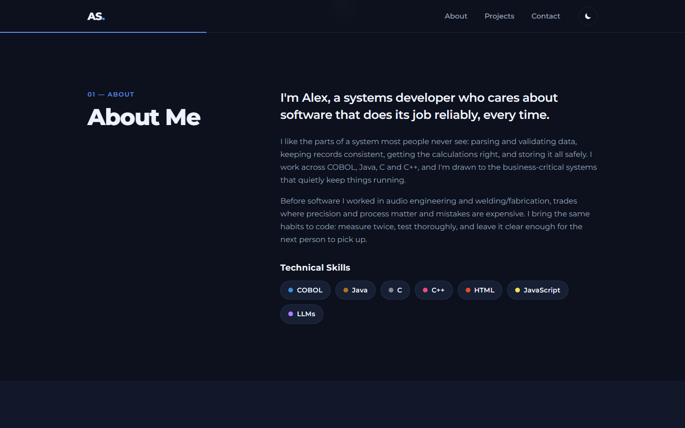
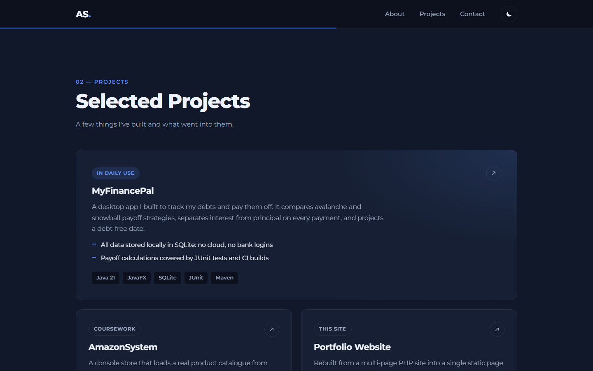
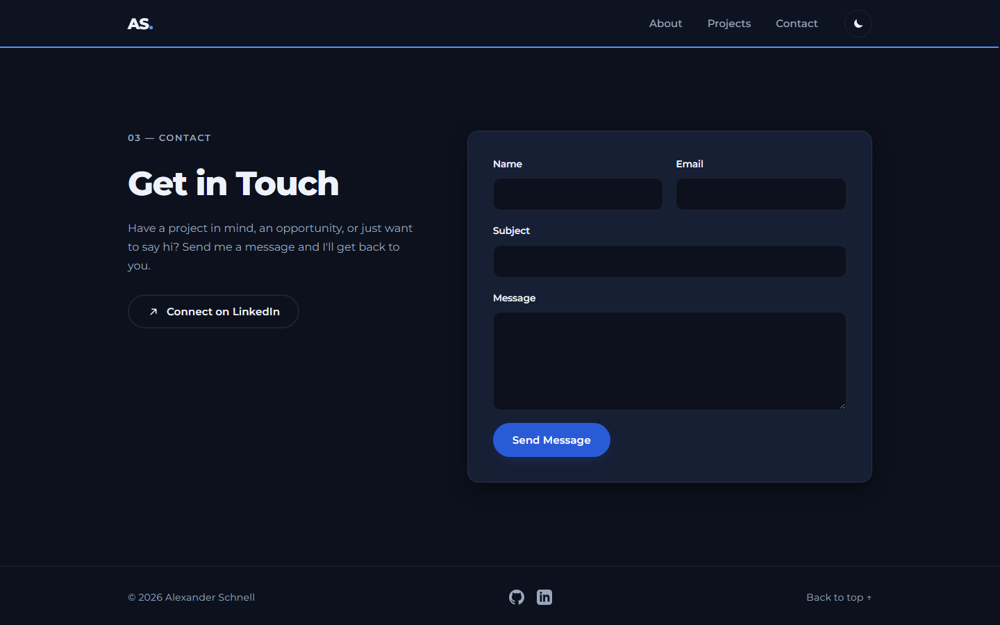

# Portfolio Website

My personal portfolio: a single, scrolling page built with plain HTML, CSS and JavaScript. No frameworks, no build step, no backend.


## Features

- **Single-page layout:** Home, About, Projects and Contact sections with smooth scrolling and a sticky nav that highlights the current section
- **Dark mode by default:** a light-mode toggle that remembers your choice
- **Selected projects:** hand-picked project cards, written straight into the page
- **Contact form:** sends messages through Formspree, so no email address or password lives in the code
- **Responsive:** works on phones, tablets and desktops, with a collapsible mobile menu
- **Subtle motion:** scroll-reveal animations and a scroll-progress bar, both switched off when the visitor has asked for reduced motion

## Running Locally

Serve the folder with any static file server, for example:

```
python -m http.server 8000
# or
npx serve .
```

Then open http://localhost:8000. It can be hosted as-is on GitHub Pages, Netlify or Vercel.

## Contact Form

Messages go through [Formspree](https://formspree.io) and are delivered to the email address on my Formspree account, which never appears in this code. The endpoint is set in `FORM_ENDPOINT` in `js/contact.js`. A hidden honeypot field (`_gotcha`) filters out spam bots.


## Project Structure

```
├── assets/
│   └── images/            favicon, screenshots
├── css/
│   └── style.css          all styles (light and dark theme tokens)
├── js/
│   ├── main.js            theme, nav, greeting, scroll effects
│   └── contact.js         contact form submission
├── index.html
└── README.md
```

## Screenshots

| About | Projects | Contact |
|---|---|---|
|  |  |  |
