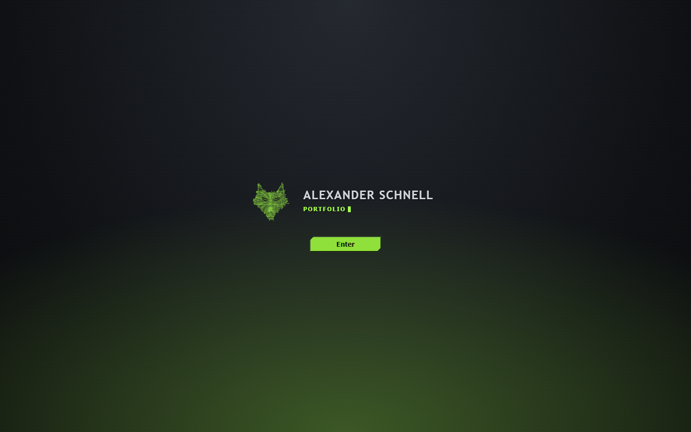

# Portfolio Website

**Live site:** https://alexanderschnell.github.io/portfolio-website/

My personal portfolio, styled as an early-2000s desktop: each section is a window, the navigation is a taskbar, and there's a Start menu. It's a single page built with plain HTML, CSS and JavaScript. No frameworks, no build step, no backend.



## Features

- **Log-on screen:** a dark, minimal entry screen in the current skin's colours: an original animated ASCII wolf, a name that decrypts into place and a slowly pulsing backlight. Pressing Enter plays a short synthesized startup chime, once per visit.
- **Desktop layout:** Welcome and New Message windows, a Projects folder and readme.txt, with a taskbar that highlights the window you're viewing
- **Projects folder:** goalstat.exe replays real reports from my COBOL project on a dot-matrix printer, myfinancepal.exe is a live debt payoff calculator on sample data, and visualizer.exe reacts to your microphone or a music file
- **Real window buttons:** Minimize, Maximize/Restore (or double-click the title bar) and Close work on every window; the welcome.exe desktop icon or the taskbar brings Welcome back
- **Start menu and clock:** the Start button opens a menu with every section and link, and the tray shows the time
- **Six skins:** Display Properties (the monitor icon in the tray) switches between Night LCD (the default), Olive Drab, Luna Blue, Silver Metal, Aero Glass and Y2K Cyber. The site remembers your choice.
- **Movable icons:** drag the desktop shortcuts anywhere with a mouse. A quick click still opens them.
- **Bit the desktop droid:** a small original robot on jet boots that flies around the desktop and lands on windows
- **"Not Responding" easter egg:** shake the Welcome window hard while dragging it and it panics, leaving a frozen trail across the screen
- **Contact form:** sends messages through Formspree, so no email address or password lives in the code
- **Responsive:** works on phones, tablets and desktops; on small screens the icons line up across the top and the Start menu handles navigation
- **Accessible motion:** window animations switch off when the visitor has asked for reduced motion

All artwork is original. The look is an homage to the era and doesn't use any real operating-system or game logos.

## Running Locally

Serve the folder with any static file server, for example:

```
python -m http.server 8000
# or
npx serve .
```

Then open http://localhost:8000. The live site is hosted on GitHub Pages and redeploys automatically on every push to `main`.

## Adding a Skin

Each skin is a block of colour variables in `css/style.css` (for example `[data-skin="aero"] { ... }`) plus one entry in the `SKINS` list in `js/main.js`. Skins belong to one of two families that set the shapes: `light` (glossy, rounded chrome) or `dark` (flat, beveled panels).

## Contact Form

Messages go through [Formspree](https://formspree.io) and are delivered to the email address on my Formspree account, which never appears in this code. The endpoint is set in `FORM_ENDPOINT` in `js/contact.js`. A hidden honeypot field (`_gotcha`) filters out spam bots.

## Project Structure

```
├── assets/
│   └── images/            wolf favicon, screenshots
├── css/
│   └── style.css          all styles and skin colour variables
├── js/
│   ├── main.js            log-on wolf, skins, Start menu, clock, windows
│   ├── sound.js           startup chime and tray mute toggle
│   ├── droid.js           Bit, the desktop droid
│   ├── goalstat.js        goalstat.exe printer
│   ├── myfinancepal.js    myfinancepal.exe calculator
│   ├── visualizer.js      visualizer.exe
│   └── contact.js         contact form submission
├── index.html
└── README.md
```

## Screenshots

| Desktop | New Message | Projects |
|---|---|---|
|  |  |  |
